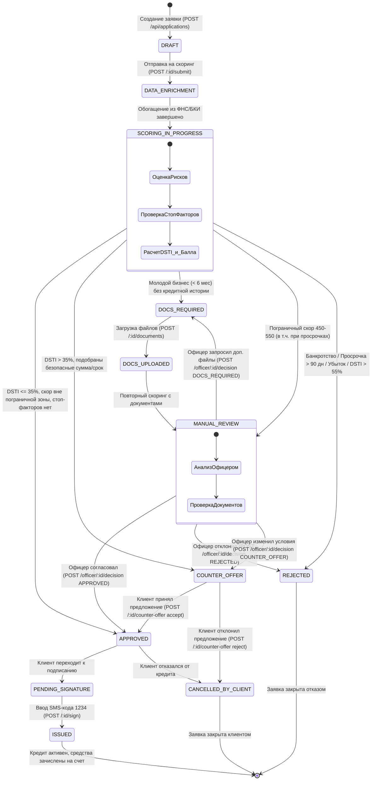

# Диаграмма состояний кредитного конвейера (State Machine)

В данном документе описан полный жизненный цикл кредитной заявки для малого и среднего бизнеса (МСБ) в сервисе **Alfa Biz Credit AI**. Модель состояний строго соответствует требованиям Банка России к аудируемости автоматизированных решений и покрывает все 12 зарегистрированных статусов.

---

## 1. Реестр статусов заявки (12 состояний)

| № | Статус | Роль / Актор | Описание состояния |
|---|--------|--------------|--------------------|
| 1 | `DRAFT` | Клиент | Черновик заявки. Клиент выбрал продукт, указал сумму, срок и цель кредитования. |
| 2 | `DATA_ENRICHMENT` | Бэкенд / ФНС | Обогащение профиля компании данными из внешних реестров (ФНС, ЕГРЮЛ, финотчетность). |
| 3 | `SCORING_IN_PROGRESS` | ML-сервис | Активный расчет скоринга рисков: вычисление DSTI, расчет скор-балла, оценка стоп-факторов и генерация LLM-объяснения. |
| 4 | `APPROVED` | Система / Офицер | Кредит одобрен на запрошенных (или согласованных) условиях. Ожидает инициации подписания клиентом. |
| 5 | `COUNTER_OFFER` | ML-сервис / Офицер | Встречное предложение. Запрошенная сумма/срок превышают безопасный DSTI; банк предлагает сниженную сумму или увеличенный срок. |
| 6 | `DOCS_REQUIRED` | ML-сервис / Офицер | Дозапрос документов. Требуется подтверждение финансовой отчетности (бухгалтерский баланс, ОПУ, декларации). |
| 7 | `DOCS_UPLOADED` | Клиент | Клиент загрузил требуемые файлы документов (PDF, скан-копии). |
| 8 | `MANUAL_REVIEW` | Кредитный офицер | Заявка передана на ручной андеррайтинг сотруднику банка (пограничный скор 450–550, либо после загрузки документов). |
| 9 | `REJECTED` | ML-сервис / Офицер | Отказ в выдаче кредита (наличие стоп-факторов: банкротство, просрочки > 90 дней, отрицательная прибыль, DSTI > 55%). |
| 10 | `PENDING_SIGNATURE` | Клиент / SMS | Процедура заключения договора: сформирован график платежей, ожидается ввод одноразового SMS-кода подтверждения. |
| 11 | `ISSUED` | Система / АБС | Финальный успешный статус. Договор подписан, кредитные средства мгновенно зачислены на расчетный счет компании. |
| 12 | `CANCELLED_BY_CLIENT` | Клиент | Заявка аннулирована клиентом (отказ от встречного предложения или добровольный отзыв заявки). |

---

## 2. Диаграмма переходов (Mermaid stateDiagram-v2)

---

## 3. Таблица триггеров и условий переходов

| Исходный статус | Целевой статус | Триггер / Эндпоинт | Условие перехода | Комментарий в Audit Log |
|---|---|---|---|---|
| *—* | `DRAFT` | `POST /api/applications` | Корректные `product_id`, `amount`, `term_months`, `purpose` | `"Заявка создана клиентом"` |
| `DRAFT` | `DATA_ENRICHMENT` | `POST /api/applications/:id/submit` | Заявка в статусе DRAFT | `"Заявка передана на скоринг рисков"` |
| `DATA_ENRICHMENT` | `SCORING_IN_PROGRESS` | Внутренний вызов Go-бэкенда | Успешное получение финансовых метрик компании | `"Заявка передана на скоринг рисков"` |
| `SCORING_IN_PROGRESS` | `APPROVED` | ML-сервис скоринга | DSTI $\le 35\%$, скор вне зоны 450–550, нет стоп-факторов | LLM-объяснение одобрения |
| `SCORING_IN_PROGRESS` | `COUNTER_OFFER` | ML-сервис скоринга | DSTI $> 35\%$, подобраны безопасные сумма/срок под $PMT_{max}$ | LLM-объяснение параметров оффера |
| `SCORING_IN_PROGRESS` | `DOCS_REQUIRED` | ML-сервис скоринга | Возраст бизнеса $< 6$ мес. и отсутствует кредитная история | `"Требуется бухгалтерская отчетность"` |
| `SCORING_IN_PROGRESS` | `MANUAL_REVIEW` | ML-сервис скоринга | Пограничный скор 450–550 (в т.ч. при наличии просрочек) | `"Пограничный скоринг-балл, направлено андеррайтеру"` |
| `SCORING_IN_PROGRESS` | `REJECTED` | ML-сервис скоринга | Стоп-фактор: банкротство, просрочка $> 90$ дней, убыток, DSTI $> 55\%$ | Причина отказа + разъяснение нейросети |
| `DOCS_REQUIRED` | `DOCS_UPLOADED` | `POST /api/applications/:id/documents` | Загружен файл (PDF, PNG, JPG $\le 5$ МБ) | `"Клиент загрузил подтверждающие документы: <файл>"` |
| `DOCS_UPLOADED` | `MANUAL_REVIEW` | Повторный вызов скоринга | Флаг `documents_uploaded: true` | `"Документы приняты, направлены кредитному офицеру"` |
| `COUNTER_OFFER` | `APPROVED` | `POST /:id/counter-offer` (`accept`) | Действие клиента `accept` | `"Клиент принял встречное предложение банка"` |
| `COUNTER_OFFER` | `CANCELLED_BY_CLIENT` | `POST /:id/counter-offer` (`reject`) | Действие клиента `reject` | `"Клиент отклонил встречное предложение банка"` |
| `MANUAL_REVIEW` | `APPROVED` | `POST /officer/:id/decision` | Решение офицера `APPROVED` | Комментарий кредитного офицера |
| `MANUAL_REVIEW` | `REJECTED` | `POST /officer/:id/decision` | Решение офицера `REJECTED` | Обоснование отказа кредитным офицером |
| `MANUAL_REVIEW` | `COUNTER_OFFER` | `POST /officer/:id/decision` | Решение офицера `COUNTER_OFFER` | Встречные условия кредитного офицера |
| `APPROVED` | `PENDING_SIGNATURE` | Внутренний шаг подписания | Клиент запросил отправку SMS-кода | `"Формирование договора и отправка кода подтверждения"` |
| `PENDING_SIGNATURE` | `ISSUED` | `POST /api/applications/:id/sign` | Введен код подтверждения `1234` | `"Кредитный договор подписан кодом 1234. Средства зачислены на счёт компании"` |
| `APPROVED` | `CANCELLED_BY_CLIENT` | `POST /:id/counter-offer` (`reject`) | Отказ клиента от заключения договора | `"Заявка аннулирована по инициативе клиента"` |

---

## 4. Журнал аудита (Audit Trail / Timeline)

Каждый переход состояния автоматически фиксируется в реляционной таблице `application_status_logs`:
* **Неизменяемость (Append-Only):** логи статусов только добавляются, модификация или удаление запрещены.
* **Сквозная хронология:** записи содержат метку времени `created_at` с точностью до миллисекунд и сортируются по возрастанию.
* **Объяснимость решений (XAI):** при автоматических переходах в поле `comment` помещается полный текст объяснения LLM (`ai_explanation`), позволяя воспроизвести аргументацию скоринга при проверках регулятора.
